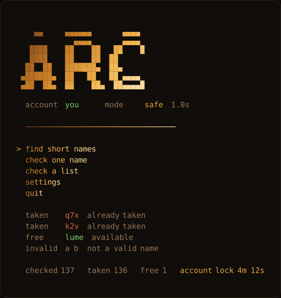

<div align="center">

# Discord Short Username Checker

**Консольный инструмент для поиска коротких ников Discord.**
Цветные результаты, контроль лимитов, опциональный пул IP — без сторонних пакетов.

[](https://github.com/Apatiym/discord-username-checker/actions/workflows/ci.yml)
[](https://www.python.org/)
[](#требования)
[](LICENSE)
[](#требования)

[English](README.md) · **Русский**

</div>

---

## О проекте

Это консольная программа с одной задачей: спросить у Discord, свободен ли ник, и
сделать это настолько быстро, насколько позволяют лимиты, не упираясь в них.
Результат печатается как `taken` красным и `free` зелёным, а самый короткий
свободный ник можно сразу поставить в профиль, не выходя из терминала.

Проект построен вокруг трёх вещей, которые обычно игнорируют:

1. **Discord жёстко лимитирует ники.** Каналов два, бюджеты разные, а запрос,
   отправленный во время блокировки, **продлевает** её.
2. **Python медленный на TLS.** Новый хендшейк на каждый запрос — это ~400 мс.
   Keep-alive снижает до ~70–140 мс, то есть быстрее, чем API успевает ответить.
3. **Токен — это твой аккаунт.** Ничего не захардкожено, ничего не отправляется
   наружу, а единственный файл с токеном закрыт в `.gitignore`.

## Возможности

| | |
|---|---|
| **Два состояния результата** | `taken` красным, `free` зелёным, `invalid` серым — без двусмысленности |
| **Меню под клавиатуру** | стрелки или `W`/`S`, `Enter` — выбор, цифры — быстрый переход |
| **Настоящий посимвольный градиент** | 24-битный ANSI, откат на 256 цветов и на чистый ASCII |
| **Анимации без мерцания** | блочный логотип, sweep, reveal, живая строка прогресса |
| **AIMD-пейсинг** | линейное снижение на успехе, кратное увеличение на `429` — как в TCP |
| **Раздельные каналы** | аккаунт-канал и IP-канал считаются отдельно, у каждого свой лок |
| **Автопоиск клиента** | находит папку данных Discord (stable / PTB / Canary / Dev) или вы указываете сами |
| **DPAPI + AES-256-GCM** | токен расшифровывается локально из LevelDB клиента, вручную вводить не нужно |
| **Опциональный VPN-пул** | свой egress IP на каждого воркера через публичные узлы VLESS / Trojan / Hysteria2 |
| **Ноль зависимостей** | только стандартная библиотека; `sing-box` нужен лишь для пула |

## Пример работы



*Отрисовано из собственного вывода программы: градиентный логотип, цветные результаты, таймер лока.*

## Требования

| | |
|---|---|
| ОС | Windows 10 или новее — извлечение токена использует DPAPI |
| Python | 3.9+ (проверено на 3.12), только стандартная библиотека |
| Опционально | [`sing-box`](https://sing-box.sagernet.org/) для VPN-пула — идёт в комплекте с клиентом Happ |

Linux и macOS не поддерживаются для шага с токеном; модули там импортируются, и
юнит-тесты проходят — именно это проверяет CI.

## Установка

```bat
git clone https://github.com/Apatiym/discord-username-checker.git
cd discord-username-checker
start.bat
```

Либо без клонирования: скачать ZIP, распаковать, запустить `start.bat`. Или напрямую:

```bat
python ds_username.py
```

`start.bat` сам находит интерпретатор Python 3 (`LOCALAPPDATA`, затем `py -3`, затем
`python`), включает UTF-8 и ставит паузу при ошибке.

При первом запуске `config.json` создаётся из встроенных значений по умолчанию. Он
в `.gitignore`, потому что в нём оказывается токен.

## Использование

### Меню

| Пункт | Действие |
|---|---|
| `find short names` | генерирует случайные ники выбранной длины и проверяет их параллельно |
| `check one name` | один ник — один ответ |
| `check a list` | читает файл (по умолчанию `names.txt`), по одному нику в строке |
| `settings` | путь, токен, воркеры, режим, IP-канал, VPN |
| `quit` | выход |

Когда находится свободный ник, программа предлагает поставить его в профиль: `Enter`
применяет, любой другой ввод оставляет текущий. Списки санируются — пустые строки,
дубликаты, `@`, пробелы и слишком длинные строки отбрасываются.

### Настройки

| Группа | Что меняется |
|---|---|
| `path` | автопоиск, ручной ввод или оставить текущую папку Discord |
| `token` | найти автоматически, вставить вручную или забыть |
| `workers` | от 1 до 16 параллельных воркеров |
| `mode` | `safe` (AIMD, по умолчанию), `fast` (без задержки), `custom` |
| `ip channel` | разрешить маленький IP-канал при наличии токена |
| `vpn` | включить пул, задать размер (1–40), обновить список узлов |

## Как это работает

### Два канала, два лимита

| Канал | Эндпоинт | Бюджет | Лок после исчерпания |
|---|---|---|---|
| аккаунт | `users/@me/pomelo-attempt` | ~150 проверок | 5–6 мин |
| IP | `unique-username/username-attempt-unauthed` | ~19 проверок | 25–35 мин |

Программа сначала берёт аккаунт-канал, затем откатывается на IP-канал. Когда сгорели
оба — останавливается и печатает остаток времени по каждому.

Запрос, отправленный **во время** лока, продлевает его — измерено: 5 минут
превратились в 32. Поэтому лок запоминается с запасом в 3 минуты, и до его истечения
не отправляется ничего.

### Скорость

Узкое место — не программа: соединения держатся живыми, поэтому запрос стоит
~70–140 мс вместо ~400 мс через `urllib`.

| Режим | Задержка | Поведение |
|---|---|---|
| `safe` *(по умолчанию)* | 1.0 с, AIMD до 0.4 с | едет по краю лимита |
| `fast` | 0 | залп; лок примерно после 150 проверок |
| `custom` | ваше число | — |

Темп регулируется как в TCP: каждый успех снимает 0.012 с, мягкий `429` умножает
задержку на 2.2. В safe-режиме задержка не опускается ниже 0.4 с — ниже снова
начинается залп. Задержка, достигнутая к концу прогона, сохраняется, и следующий
старт начинается с неё.

### Токен

`settings → token → find`; программа также пробует при старте.

1. `%APPDATA%\discord\Local State` → `os_crypt.encrypted_key`
2. `CryptUnprotectData` (DPAPI через `ctypes`) → ключ AES-256-GCM
3. `%APPDATA%\discord\Local Storage\leveldb\*.ldb|*.log` → `dQw4w9WgXcQ:v10…`
4. Расшифровка AES-256-GCM с проверкой тега
5. `GET /users/@me` подтверждает токен и печатает ник

Проверяются все клиенты: `discord`, `discordptb`, `discordcanary`, `discorddevelopment`.
`…\AppData\Local\Discord` — это только папка **установки**, данные лежат рядом, в
`…\AppData\Roaming\discord`.

Папка находится автоматически, ничего не захардкожено, поэтому программа работает на
любой машине. Если найти не удалось — спросит один раз, а `settings → path` принимает
папку данных, папку установки, `Local State`, саму папку `leveldb`, путь в кавычках
или `%APPDATA%\discord` — всё сводится к одной и той же папке.

### VPN-пул

`settings → vpn` может отправлять каждый запрос с другого IP, используя публичные
списки из [igareck/vpn-configs-for-russia](https://github.com/igareck/vpn-configs-for-russia).

Python не умеет эти протоколы, поэтому туннель делает `sing-box`:

```text
наш код → HTTP-прокси 127.0.0.1:PORT → outbound sing-box → узел → Discord
```

Программа скачивает списки, разбирает VLESS (включая Reality), Trojan и Hysteria2 и
пишет один конфиг sing-box, где inbound-порт *i* маршрутизируется в outbound *i*.
Каждый воркер берёт свой порт, поэтому параллельные воркеры действительно используют
разные IP. Узлы, переставшие отвечать, выпадают из ротации; живые запоминаются в
`vpns.json` (в `.gitignore`), чтобы следующий старт был быстрее. Холодный старт ≈ 8–11 с,
тёплый ≈ 8 с.

Реалистично о том, что это даёт:

- **IP-канал** лимитируется по IP, поэтому *N* узлов умножают его бюджет;
- **аккаунт-канал** лимитируется по токену — сколько угодно IP его не сбросят.

Бесплатные публичные узлы нестабильны: на момент написания разобралось 58 узлов,
трафик прошли 14–16, что дало 13–14 уникальных egress IP.

## Конфигурация

`config.json`, создаётся при первом запуске и находится в `.gitignore`:

| Ключ | Значение |
|---|---|
| `mode` | `safe`, `fast` или `custom` |
| `delay` | секунды между проверками |
| `workers` | число параллельных воркеров |
| `use_ip` | разрешить IP-канал при наличии токена |
| `vpn` | `{"enabled": bool, "size": int}` |
| `discord_path` | папка данных клиента, определяется при первом запуске |
| `token`, `me` | учётные данные и кэш профиля |
| `locks` | канал → момент истечения лока |

## Архитектура

```text
ds_username.py   меню, сканирование, смена ника, настройки
├── net.py       keep-alive HTTP-клиент, определение прокси, пул sing-box
├── creds.py     извлечение токена через DPAPI + AES-256-GCM
└── ui.py        логотип, посимвольный градиент, анимации
```

`ds_username.py` держит поток управления; остальные три — библиотеки без побочных
эффектов при импорте. Такое разделение держит каждый файл меньше ~1500 строк и
позволяет тестировать сетевой и криптографический слои отдельно.

| Файл | Ответственность |
|---|---|
| `ds_username.py` | CLI, меню, `Pacer`, `Gate`, выбор канала, сканирование, обновление профиля |
| `net.py` | `Session`, `Client` (ротация по пулу), `Pool`, парсеры URI, сборка конфига sing-box |
| `creds.py` | расшифровка AES-GCM, распаковка DPAPI, обход LevelDB |
| `ui.py` | палитра, градиент, `Loader`, `ScanLine`, `reveal`, `sweep` |
| `tests/` | офлайн-тесты (без сети и без аккаунта Discord) |
| `docs/demo.svg` | картинка-превью выше, собранная из реального вывода программы |

## Разработка

```bat
python -m unittest discover -s tests -v
python -m py_compile ds_username.py net.py ui.py creds.py
```

Тесты не обращаются к сети и не читают ваш настоящий `config.json` — путь к конфигу
подменяется на временный файл.

## Решение проблем

| Симптом | Причина и решение |
|---|---|
| `token not found` | Вы не вошли в клиент Discord или сборка портативная. Войдите один раз либо вставьте токен в `settings → token`. |
| `path not found` | Клиент ни разу не запускался на этой машине. Укажите `%APPDATA%\discord` в `settings → path`. |
| `SSL: WRONG_VERSION_NUMBER` | Прямой доступ к `discord.com` заблокирован. Клиент сам находит локальный прокси — сначала запустите VPN/прокси. |
| `account lock 5m` | Это норма. Дождитесь — запрос во время лока его продлевает. |
| `nothing free` | Канал исчерпан; в футере остаток времени. |
| Цвета выглядят неверно | `NO_TRUECOLOR=1` принудительно включает палитру на 256 цветов. |
| Анимации тормозят | `NO_ANIM=1` отключает их. |

## Отрезвляющая статистика

Замерено на одном аккаунте на случайных никах:

| Длина | Свободно из случайных |
|---|---|
| 3 | 0 из 25 |
| 4 | 0 из 12 |
| 5 | 9 из 10 |
| 6 | 10 из 10 |

Трёх- и четырёхсимвольные ники разобрали годы назад; перебор там почти всегда впустую.
Пять символов — реалистичная цель, а лучшая стратегия — проверять конкретный нужный
ник, а не случайные.

## Ограничения

- Капчу при смене ника обойти нельзя — меняйте в клиенте.
- `config.json` хранит токен в открытом виде. Он в `.gitignore`; если делитесь ZIP —
  удалите файл заранее.
- VPN-пул помогает только IP-каналу. Аккаунт-канал привязан к токену.
- Публичные узлы бесплатны и потому ненадёжны: пул может уменьшиться между запусками.

## Дисклеймер

Используйте это на **своём** аккаунте. Лимиты и Terms of Service Discord продолжают
действовать: программа старается держаться **под** лимитами, а не обходить их.
Автоматизированный захват ников может нарушать ToS — ответственность за использование
на вас.

## Участие

Issues и pull requests приветствуются — см. [CONTRIBUTING.md](CONTRIBUTING.md).
По вопросам безопасности сначала прочитайте [SECURITY.md](SECURITY.md).

## Лицензия

[MIT](LICENSE) © Apatiym
